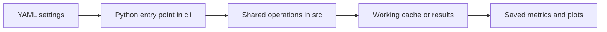
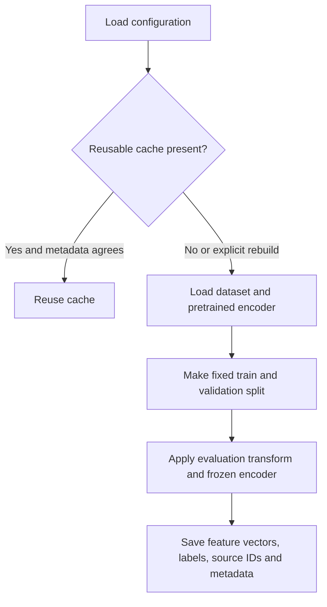
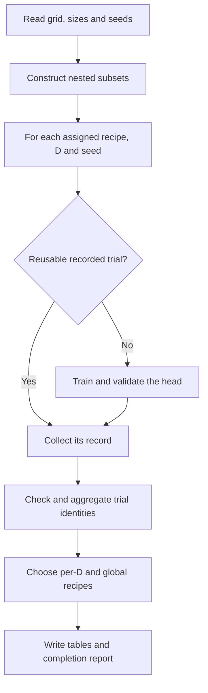
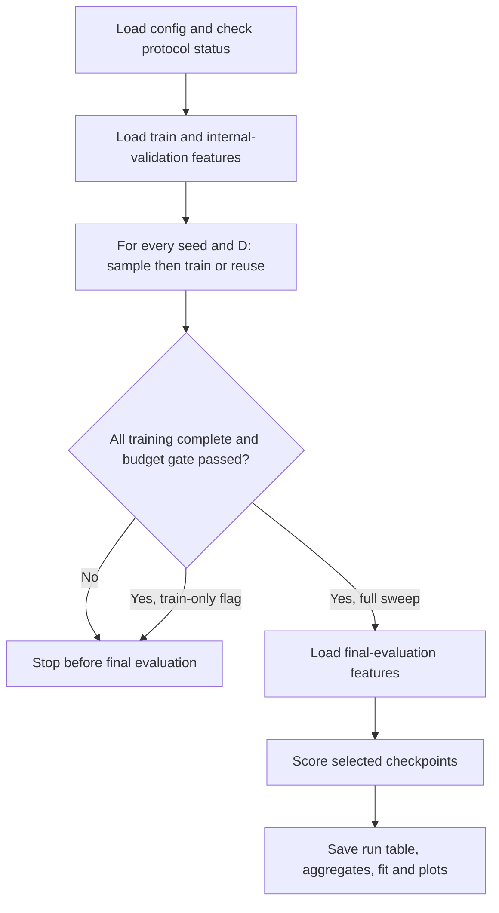

# Understand the scripts: simple flows and pseudocode

Read this as a map, not as instructions to launch every program. A **script** is a recipe for the computer. A **configuration** supplies ingredients and quantities. A **module** is a reusable part of a recipe. A shell launcher runs several Python recipes in order. None of these filenames is a separate scientific finding.

The starting question is: “How many labeled examples does a classifier need when its image representation stays fixed?” The representation is frozen. Only the final affine classifier learns.



Use the [implementation README](implementation.md) for exact command context. The flows below describe this repository version, which is not proved to be the exact historical version of every experiment. Explanations of why a choice is useful are retrospective reasoning unless a dated protocol states the original reason.

## 1. `cli/check_environment.py` — describe the machine

[Source](../cli/check_environment.py). Input: current Python/PyTorch installation. Output: printed versions, CUDA/device information. It helps explain where a run executes; it does not prove that every dependency works or reproduce a historical environment.

`Read runtime metadata → print each item → finish`

```text
information = ask the runtime for versions and devices
for each name and value:
    print name and value
```

## 2. `cli/prepare_features.py` — turn images into reusable numbers

[Entry point](../cli/prepare_features.py) calls [feature_cache.py](../src/feature_cache.py). Inputs: config, image dataset, pretrained weights. Outputs: feature/label/ID tensor files and metadata in a working cache. It may download data or weights and can be expensive.



```text
read settings and choose the dataset
if a cache exists and matches the checked settings:
    reuse it
otherwise:
    load the encoder without its original classifier
    split the training images into pool and internal validation
    for each image batch in each split:
        transform images; compute frozen features
    save features, labels, IDs and descriptive metadata
```

Why cache? The encoder never changes, so repeated head trials can reuse its output. Limitation: cache metadata does not fully authenticate original image content or feature-label alignment; the original historical cache is unavailable locally. `--force` can rebuild cache evidence and should not be used on an original archival cache casually.

## 3. `cli/run_hpo.py` — choose classifier settings with validation

[Source](../cli/run_hpo.py). HPO means hyperparameter optimization. It enumerates recipe combinations; it is not a separate neural network. Inputs: HPO YAML and training/internal-validation cache. Outputs: trial metrics, selected heads in working results, aggregated validation tables and selections. It does not score the final-evaluation split.



```text
build the planned combinations of LR, WD, schedule and batch size
for each seed and D:
    determine the selected source examples
    for each recipe assigned to this shard:
        reuse a recorded trial or train a new head using internal validation
when aggregating:
    compare expected and observed trial identities
    average validation losses over seeds at each D
    choose one recipe by average relative regret over D
    save evidence, selection and completeness
```

A **shard** is a numbered part of the work. The shell launchers execute their shards sequentially; sharding alone is not parallelism. `--dry-run` only prints the plan. `--aggregate-only` collects existing trials, but known reuse/binding weaknesses mean its completion flag is not sufficient archival certification. `--force` reruns recorded work. The global regret choice balances sizes, rather than optimizing every size independently.

## 4. `cli/promote_places365_final_config.py` — write an accepted recipe into templates

[Source](../cli/promote_places365_final_config.py). Input: HPO completion, snapshot, aggregate and selection. Output: rewritten final/smoke YAMLs when checks pass; otherwise failure messages. This is a writing operation, not training.

`Read HPO evidence → check completeness, boundary and budget rules → reject or rewrite recipe/status`

```text
read the selected recipe and search evidence
collect every failed acceptance condition
if any failed condition exists:
    print failures and stop
otherwise:
    write the recipe into final and smoke configuration files
```

Why check boundaries? A winner at the largest tested WD may mean the optimum lies outside the tested range. A passed boundary check only concerns that grid; it is not a mathematical optimum. The promotion program does not fully bind acceptance to every scientific target condition, so its output requires review. The preserved blocked templates differ from the executed approved snapshot; the report uses the latter as historical evidence.

## 5. `cli/run_sweep.py` — run the fixed-recipe experiment

[Source](../cli/run_sweep.py). Inputs: one recipe, list of D values/seeds, cached features. Outputs: heads, histories, metrics, completion, summary, fit and plots under working `results/`.



```text
check the configuration and allowed protocol status
build nested subsets separately for each seed
for each D and seed:
    fit the head using training features and internal validation
if train-only was requested:
    stop with final data closed
if runs are missing or budget warnings exist:
    stop
for each selected head:
    measure final loss and accuracy
summarize results and fit the curve
```

Why train before final evaluation? The intended procedure avoids selecting recipes/checkpoints on final scores. This program's reuse paths and historical chronology are not fully certified. A metadata string saying “noiseless” does not add a communication channel. `--dry-run` does not perform training; without it, substantial work can occur.

## 6. `cli/analyze_results.py` — summarize a run table

[Source](../cli/analyze_results.py) calls [scaling.py](../src/scaling.py). Input: a results directory containing `summary.csv`. Output: rewritten aggregate CSV, fit JSON and two PNGs in that same directory.

`Run rows → group by D → mean and sample SD → fit loss function → write plots`

```text
read the run table
check required numeric columns
for each D:
    calculate mean loss/accuracy, sample SD and seed count
fit positive floor + b times D to the power minus beta
write aggregates, parameters and plots
```

Why fit? To summarize how loss decreases over the measured range and generate testable predictions. A smooth curve is not proof of a universal law. This older analysis helper is not the stronger compact-evidence verifier; do not use it to overwrite original artifacts. Work on a separate copy.

## 7. `cli/compare_sweeps.py` — compare already measured curves

[Source](../cli/compare_sweeps.py). Inputs: named result directories and a separate output directory. Outputs: comparison table and figures.

`Read saved aggregates → align sizes → display curves → save comparison`

```text
for each named result collection:
    load its aggregate table
combine the reported measurements by D
draw the curves with labels and seed SD
write the derivative table and figures
```

The program does not retrain models or make old runs scientifically matched. A before/after difference can also reflect stopping, schedule or grid changes. Consult snapshots before interpreting it as the effect of a single hyperparameter.

## 8. `cli/verify_artifacts.py` — check saved arithmetic and identities

[Source](../cli/verify_artifacts.py). This small program was added for the organization. Inputs: compact artifact files. Outputs: printed JSON, optionally a separate verification file. It does not train or inspect original images.

```text
for each saved sweep:
    check exact D/seed identities and valid metrics
    independently recompute means and sample SD
    check completion and optionally refit the saved curve
for each HPO search:
    check the exact configured grid
    recompute validation aggregates and global regret winner
report passed checks or stop at a discrepancy
```

Why another checker? A summary can look plausible even with missing or duplicated rows. This checks tables against the saved plan. It cannot prove that the original images or feature vectors were correct; reusing the repository fitter confirms a calculation, not the model's scientific validity.

## 9. `cli/build_report_figures.py` — draw the current report

[Source](../cli/build_report_figures.py). Added for this report. Inputs: main saved tables and fits. Outputs: four PNGs under `reports/figures/`.

`Read saved numbers → draw loss/accuracy → draw residuals → compare D with exposure → save`

```text
for CIFAR and Places:
    read aggregates, individual runs and the saved fit
    draw mean loss and accuracy with one seed SD
show observed-minus-fitted relative residuals
show recorded training presentations against unique D
write the four report figures
```

D uses logarithmic spacing so small and large sizes remain visible. Vertical axes on the main panels are linear; the exposure figure uses log spacing on both axes. The builder does not fit a new model or create new measurements.

## 10. Shell launchers — sequences of Python commands

| File | Simple flow | What to know |
|---|---|---|
| [run_all.sh](../scripts/run_all.sh) | Environment → features → main CIFAR sweep | Default now selects the documented main recipe; it can perform a full expensive run |
| [run_places365_hpo.sh](../scripts/run_places365_hpo.sh) | Features → broad-search shards → aggregate | Sequential shards, logs appended with `tee` |
| [run_places365_hpo_refinement.sh](../scripts/run_places365_hpo_refinement.sh) | Features → refinement shards → aggregate | Same orchestration, different YAML/grid/budget |
| [run_places365_wd_boundary_hpo.sh](../scripts/run_places365_wd_boundary_hpo.sh) | Features → extended-WD shards → aggregate | Same orchestration, extended search |

```text
change to the experiment directory
choose the config and shard count
prepare/reuse features
for each numbered shard:
    run its Python HPO work and save the printed log
aggregate the existing trials
```

`set -euo pipefail` helps stop on command/pipeline errors or unset variables. `nice -n 19` lowers scheduling priority; it is not a GPU memory limit. `tee -a` both displays output and appends it to a log, so an old log can contain multiple attempts. Log paths assume default experiment names; custom runs should use explicit Python commands/output settings.

## 11. `scripts/build_historical_comparison.py` — preserved comparison plot recipe

[Source](../scripts/build_historical_comparison.py). It reads three saved CIFAR curves from `artifacts/`, joins measurements and writes the historical comparison CSV and two figures under `reports/figures/historical_comparison/`. Its flow is **read old aggregates → align sizes → draw log/linear views → save derivatives**. It has no training logic. Rerunning changes plot derivatives, not original measured tables; grid/recipe differences prevent a controlled single-factor conclusion.

## 12. Shared modules: which operation lives where?

| Module | Flow and simple pseudocode | Why it exists |
|---|---|---|
| [config.py](../src/config.py) | YAML → dictionary → check known values: `load; validate; return` | Catch impossible sizes, budgets or incompatible dataset settings; unknown scientific keys remain a concern |
| [sampling.py](../src/sampling.py) | Labels + IDs + seed → class ordering → nested prefixes | Add data without replacing earlier membership; keep the task's classes represented |
| [probe.py](../src/probe.py) | Features → head → batch updates → validation → selected state → evaluation | Shared training/evaluation logic avoids different trainers in HPO and main sweeps |
| [hpo.py](../src/hpo.py) | Trial records → groups → mean losses → per-D/global selection | Keep the validation selection rule explicit |
| [sweep.py](../src/sweep.py) | Trial metrics → near-budget decision | Warn that a selected checkpoint near the limit may need more training; this is a heuristic |
| [feature_cache.py](../src/feature_cache.py) | Images/encoder → saved feature tensors; tensors → validated inputs | Reuse a frozen representation; known identity limits remain |
| [scaling.py](../src/scaling.py) | Size-wise means → 12 positive-parameter starts → robust log fit → best candidate | Describe the loss curve; predictive checking is separate |
| [reproducibility.py](../src/reproducibility.py) | Seed/device settings → runtime state and metadata | Reduce avoidable variation and record the environment; not a bitwise-reproduction guarantee |
| [io_utils.py](../src/io_utils.py) | JSON payload → temporary file → replace destination | Reduce partial JSON writes; does not bind several files into one transaction |
| `__init__.py` in `src/` and `cli/` | Package marker; no experimental process | Makes imports/module invocation possible |

## 13. Settings, tests and artifacts

Each YAML is a settings sheet rather than a program: model/checkpoint; dataset/split/sampling/D/seeds; optimizer/stopping; runtime; and sometimes HPO candidate lists. The [configuration status table](implementation.md) describes all ten sheets and distinguishes blocked templates from executed snapshots.

Each `tests/test_*.py` file checks the module named in its filename using small synthetic inputs. Tests cover configuration, sampling, cache checks, head behavior, HPO selection, orchestration helpers and fitting; the new artifact-checker tests reject corrupted records. Passing tests support those cases, not every historical input. Requirements files list dependencies; `pytest.ini` tells pytest where this implementation and its tests live. Ignore files keep heavy working data/results out of Git. Protocol Markdown states intended scientific rules. CSV/JSON artifacts record measured numbers and execution settings. PNGs display numbers; they are not the only evidence.

For supervision, you do not need to memorize every Python line. Be able to explain each program's **question, inputs, decisions, outputs and limitations**, and trace one measured result to its configuration and individual-run row. If asked why a historical choice was made and no contemporaneous explanation exists, say: “This is the design rationale I can justify from the code and protocol; I cannot establish the exact past decision process from these files.”
