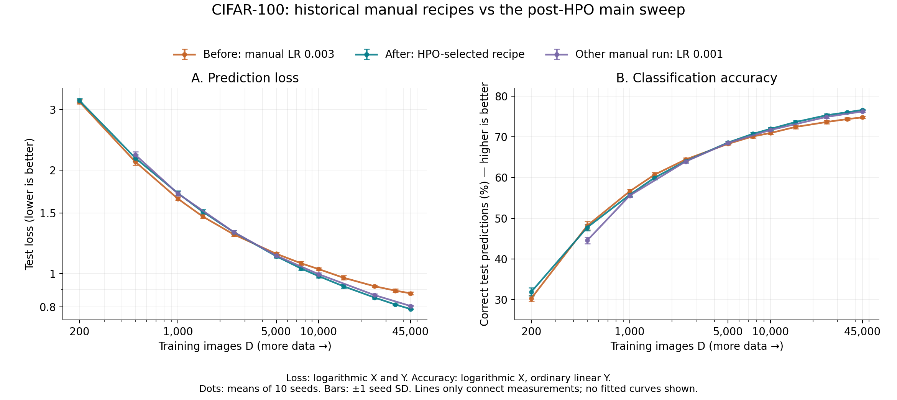

# CIFAR-100 historical comparison

The primary historical reference is `formal_lr_003`, whose configuration identifies it as the primary scaling sweep and matches the main run's 12 sizes. Manual LR 0.001 is a separate seven-size reference. This classification does not establish precise execution dates.

| Protocol | Manual LR 0.003 | Main after HPO |
|---|---|---|
| LR / WD | 0.003 / 0.0001 | 0.0001 / 0.01 |
| Schedule | Cosine (documented; default when omitted in snapshot) | Constant |
| Ceiling | 100 epochs | 30,000 steps |
| Validation interval | Every epoch | Every 20 steps |
| Patience | 15 checks | 50 checks |
| Minimum improvement | 0.0001 | 0.00001 |
| Sizes / seeds | 12 / 10 | 12 / 10 |

## Measured comparison

Positive loss reduction denotes lower post-HPO loss; accuracy change is in percentage points. These are descriptive seed-mean differences, without significance tests.

| D | Before loss | After loss | Loss reduction (%) | Before accuracy (%) | After accuracy (%) | Accuracy change (points) |
|---:|---:|---:|---:|---:|---:|---:|
| 200 | 3.1600 | 3.1867 | -0.84 | 30.29 | 31.90 | +1.610 |
| 500 | 2.1138 | 2.1677 | -2.55 | 48.18 | 47.75 | -0.429 |
| 1,000 | 1.6522 | 1.7147 | -3.78 | 56.61 | 55.75 | -0.866 |
| 1,500 | 1.4673 | 1.5148 | -3.23 | 60.69 | 59.95 | -0.746 |
| 2,500 | 1.3003 | 1.3204 | -1.55 | 64.45 | 64.03 | -0.412 |
| 5,000 | 1.1428 | 1.1242 | +1.62 | 68.28 | 68.61 | +0.323 |
| 7,500 | 1.0724 | 1.0358 | +3.42 | 70.12 | 70.73 | +0.617 |
| 10,000 | 1.0314 | 0.9840 | +4.60 | 70.94 | 71.95 | +1.016 |
| 15,000 | 0.9737 | 0.9197 | +5.55 | 72.42 | 73.62 | +1.199 |
| 25,000 | 0.9194 | 0.8524 | +7.29 | 73.64 | 75.31 | +1.665 |
| 35,000 | 0.8930 | 0.8140 | +8.85 | 74.36 | 76.04 | +1.679 |
| 45,000 | 0.8770 | 0.7894 | +9.99 | 74.78 | 76.61 | +1.826 |

Dots are means over ten seeds; bars show ± one seed SD. Lines connect measurements, not fitted laws. Loss uses logarithmic X and Y; accuracy uses logarithmic X and linear Y, expressed as percent. [Linear-axis view](comparison_linear.png) is also supplied.

In both panels, X is the number of training images, not training steps. On the left, Y is test loss and lower is better; on the right, Y is accuracy in percent and higher is better. Logarithmic spacing assigns equal distances to equal ratios: doubling D from 500 to 1,000 occupies the same width as doubling it from 5,000 to 10,000. Labels still show actual values. The accuracy panel has linear Y spacing, so 60%→65% and 70%→75% have the same height. In the linked linear-axis view, both X and Y use equal spacing for equal numerical additions.

Orange denotes the earlier manual LR 0.003 sweep, teal the completed main sweep after HPO, and purple the earlier manual LR 0.001 sweep. The figures contain completed results only; the proposed matched legacy control has no plotted results.

## Fitted parameters and largest-size results

| Experiment | beta | L_inf | Loss at D=45,000 | Accuracy at D=45,000 |
|---|---:|---:|---:|---:|
| cifar100_main | 0.520413 | 0.649303 | 0.789427 | 76.608% |
| formal_lr_003 | 0.608721 | 0.801312 | 0.877016 | 74.782% |
| formal_lr_001 | 0.521635 | 0.665473 | 0.805736 | 76.241% |

At the largest size, loss is 9.99% lower and accuracy +1.826 points versus LR 0.003; versus LR 0.001, loss is 2.02% lower and accuracy +0.367 points. The main run is not superior at every small size. Differences in schedule, budget and stopping prevent attribution to HPO or individual hyperparameters alone. The configured matched control has no completed results in this snapshot.

A larger beta is not a quality score; interpret measured loss, fitted floor and full curves together. The LR 0.001 fit uses seven points rather than twelve. Regenerate this comparison from packaged summaries with `python reports/comparison/build_figures.py`; no new test evaluation is performed.
