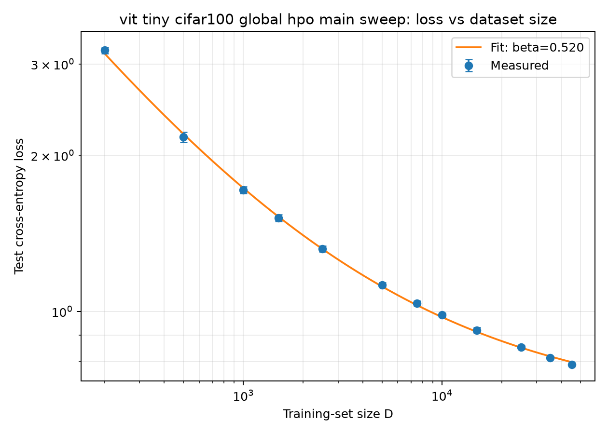
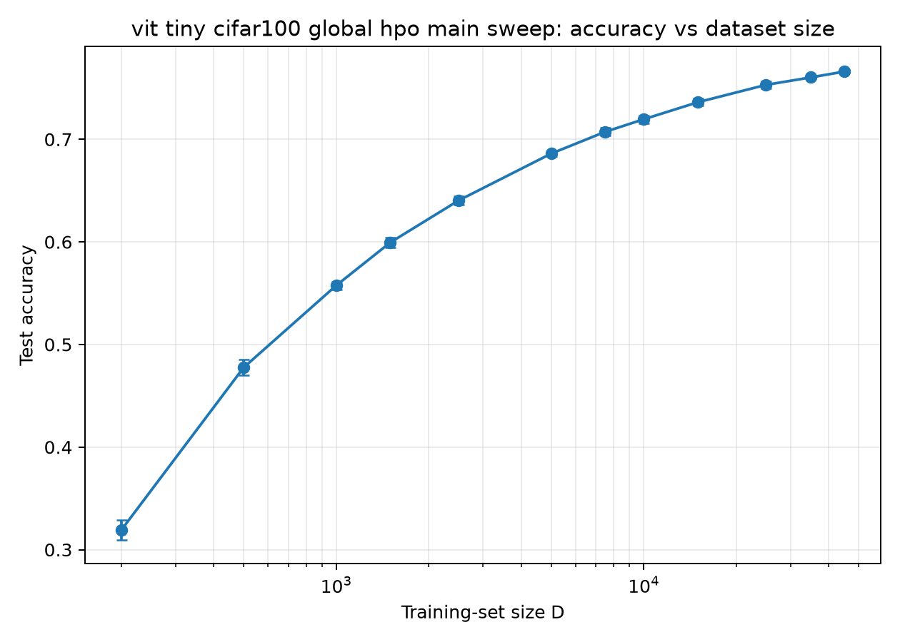

> Historical report preserved from the previous repository snapshot. Current status, methodology qualifications and complete evidence links are in the [consolidated report](../../thesis_progress.md). Navigation links below were repaired for the new layout.

# CIFAR-100 Experiment Report

Snapshot date: 1 October 2026.

**Completed post-HPO experiment:** the main CIFAR-100 sweep using the HPO-selected recipe has already been trained and test-evaluated for all 120 runs. Its measured results and figures appear below. The optional matched legacy control is a separate proposed follow-up with no completed results in this snapshot.

## Research question and design

How does held-out loss change with labeled training-set size for a fixed pretrained representation? The encoder is `vit_tiny_patch16_224.augreg_in21k_ft_in1k`, frozen throughout; cached features have width 192. Only the linear classification head is trained. This isolates labeled-data scaling conditional on this representation and training protocol; it is not end-to-end backbone training.

For CIFAR-100, the original training set is split into a 45,000-image pool and 5,000-image validation set, with a separate official 10,000-image test set. Balanced nested subsets are used within each seed. The configured batch size is 256; at D=200 the actual training batch has 200 examples.

## Experiment progression

| Stage | Evidence and outcome |
|---|---|
| Engineering smoke/pilot runs | Checked feature extraction, sampling, probe training and artifact generation; not final scaling evidence. |
| Initial formal CIFAR-100 sweep | Manual LR 0.01, WD 0.0001; seven sizes and five seeds. |
| Manual LR comparisons | LR 0.003: 12 sizes × 10 seeds; LR 0.001: seven sizes × 10 seeds. Different optimizer settings produced different performance and fitted curves. |
| LR-only pilot HPO | Registered 72-trial search; recorded global selection LR 0.001. Boundary and budget concerns motivated expanded search. |
| Core CIFAR-100 HPO | All 7,920 trials complete: 11 LRs × 6 WDs × 12 sizes × 10 seeds; zero missing, duplicate or unexpected trials in the completion record. |
| Main CIFAR-100 sweep after HPO | Completed: all 120 runs trained and test-evaluated using the selected recipe; no budget-warning runs in the supplied completion record. |
| Places365 global HPO | All 5,280 trials complete; selected LR 0.0002, WD 0.01. |
| Places365 refinement | All 2,400 trials complete; selected LR 0.0001, WD 0.3. |
| Places365 boundary extension | 1,920 registered trials; running on the remote machine. Results will be pushed to GitHub once ready. |

## CIFAR-100 selection and final protocol

Core HPO used validation only. It selected LR 0.0001, WD 0.01, batch size 256 and a constant schedule as the shared recipe across D. Selection minimizes mean relative validation regret: for each size, compare seed-mean validation loss with the best tested seed-mean loss, then average the relative excess equally over sizes. The selected recipe's mean regret was 1.1700%. Schedule and batch size were fixed, not optimized.

WD 0.01 was the upper tested boundary. The selection is therefore the global winner within the tested grid, not a universal optimum. At D=45,000, all ten per-D winning runs hit the 10,000-step budget with selected checkpoints near the limit. The main sweep increased the common ceiling to 30,000 steps, retained one recipe across all sizes, checked validation every 20 steps, and stopped after 50 checks without an accepted loss decrease greater than 0.00001.

The code separates training/validation from final checkpoint evaluation on test and blocks test evaluation when its budget-warning heuristic triggers. The supplied completion record reports 120 trained and 120 evaluated runs and no warnings. For D=45,000, recorded training stopped at 10,020–11,880 steps. Absence of the heuristic warning does not prove mathematical convergence; historical execution order is not independently reconstructed by this snapshot.

## Completed post-HPO CIFAR-100 main sweep: measured results

Mean ± one standard deviation across ten seeds. SD is not a confidence interval.

| D | Test loss | Test accuracy (%) |
|---:|---:|---:|
| 200 | 3.1867 ± 0.0421 | 31.90 ± 0.98 |
| 500 | 2.1677 ± 0.0487 | 47.75 ± 0.75 |
| 1,000 | 1.7147 ± 0.0258 | 55.75 ± 0.39 |
| 1,500 | 1.5148 ± 0.0220 | 59.95 ± 0.51 |
| 2,500 | 1.3204 ± 0.0163 | 64.03 ± 0.40 |
| 5,000 | 1.1242 ± 0.0124 | 68.61 ± 0.26 |
| 7,500 | 1.0358 ± 0.0112 | 70.73 ± 0.40 |
| 10,000 | 0.9840 ± 0.0099 | 71.95 ± 0.37 |
| 15,000 | 0.9197 ± 0.0110 | 73.62 ± 0.35 |
| 25,000 | 0.8524 ± 0.0067 | 75.31 ± 0.34 |
| 35,000 | 0.8140 ± 0.0040 | 76.04 ± 0.13 |
| 45,000 | 0.7894 ± 0.0021 | 76.61 ± 0.13 |

*Figure 1. Test loss versus training-set size for the completed post-HPO main sweep.* X is the number of training images D (200–45,000), with logarithmic spacing. Y is measured test cross-entropy loss, also with logarithmic spacing; lower is better. Tick labels show actual image counts and actual losses. Equal distances on either log axis represent equal ratios: 500→1,000 and 5,000→10,000 have the same horizontal distance, while loss 0.5→1.0 and 1.0→2.0 have the same vertical distance. Dots show ten-seed means and bars show ± one seed standard deviation. The smooth line is the fitted loss-scaling equation, not additional measurements or training progress.

*Figure 2. Test accuracy versus training-set size for the same completed sweep.* X again shows D with logarithmic spacing. Y uses ordinary linear spacing and displays accuracy as a fraction: 0.75 means 75%, and a difference of 0.01 means one percentage point. Higher is better. Dots and bars show ten-seed means and ± one seed standard deviation; the line only connects those means. No accuracy scaling equation is fitted. Equal vertical distances represent equal accuracy differences, such as 0.60→0.65 and 0.70→0.75. The table above expresses accuracy in percent.

Both figures compare separately trained classifiers at different dataset sizes; neither shows performance changing during a single training run. Logarithmic axis spacing changes the display, not the measurements. [Comparison figures](HISTORICAL_COMPARISON.md) include both logarithmic and ordinary linear-axis views.

The recorded fit is `L(D)=L_inf+b D^(-beta)` with beta=0.520413, L_inf=0.649303, b=39.320295 and log-loss RMSE=0.008571 over 12 seed-mean points. The implementation uses positive parameters, Huber residuals in log-loss space and multiple initializations. The fitted floor is inferred, not measured irreducible loss. This snapshot does not supply a verified confidence interval for the fitted parameters.

## Historical comparison

This section compares the completed post-HPO main sweep with earlier completed manual-LR sweeps. These historical references are not new or pending experiments.

At D=45,000, the main run reaches loss 0.789427 and accuracy 76.608%, versus 0.877016 and 74.782% for manual LR 0.003: 9.99% lower mean loss and +1.826 percentage points accuracy. Compared with manual LR 0.001 (loss 0.805736; accuracy 76.241%), the gain is 2.02% lower loss and +0.367 points accuracy.

Relative to LR 0.003, mean loss is lower at every measured D≥5,000 and higher below that. Accuracy is higher at D≥5,000 and D=200, but lower at D=500–2,500. Thus improvement is not universal across data sizes. Historical protocols also differ in schedule, budget and stopping rules, so the differences cannot isolate the causal effect of HPO, LR or WD. No significance test for the differences is supplied. See [comparison tables and figures](HISTORICAL_COMPARISON.md).

The matched legacy control is configured but no completed local evidence was found. It changes LR and WD together under the main protocol; it would not separate their individual effects.

## Places365 status

Global HPO selected LR 0.0002 and WD 0.01, with mean relative validation regret 0.1717%. Refinement selected LR 0.0001 and WD 0.3, with regret 0.1320%. Selected-recipe budget checks on the copied refinement trial table found no flagged runs under the 30,000-step ceiling.

WD 0.3 remained the upper tested boundary and was selected at seven of eight per-D optima. The D=1,300 per-D LR winner was also at its upper boundary. The registered extension tests six LRs (including 0.0005) and WDs 0.1, 0.3, 1.0, 3.0, across eight sizes and ten seeds. It is reported running remotely by the researcher; completion has not been verified locally. The final Places365 config remains blocked until completion, interior global selection and budget checks pass. The official labeled validation split is reserved for final held-out evaluation, distinct from the internal validation used for HPO.

## Remaining work and review decisions

1. Import and audit the Places365 extension results; promote the final recipe only after the registered gates pass.
2. Run the Places365 smoke and final training-only sweeps, then the locked held-out evaluation.
3. Decide whether the CIFAR-100 matched control is required.
4. Complete documented seed-aware uncertainty, residual and fit-range sensitivity analyses before strong extrapolation claims.
5. Retain the full raw experiment archive and establish historical code/environment provenance for final thesis reproduction.

Current source is a local implementation snapshot and is not proven to be the exact historical revision used for every recorded run. Packaging validation and provenance are documented in [REPRODUCIBILITY.md](../../../experiments/models/vit-tiny/REPRODUCIBILITY.md).
