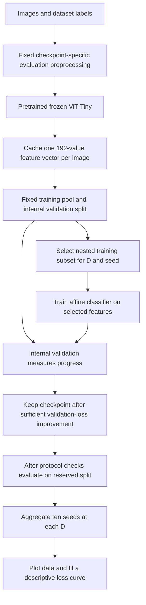
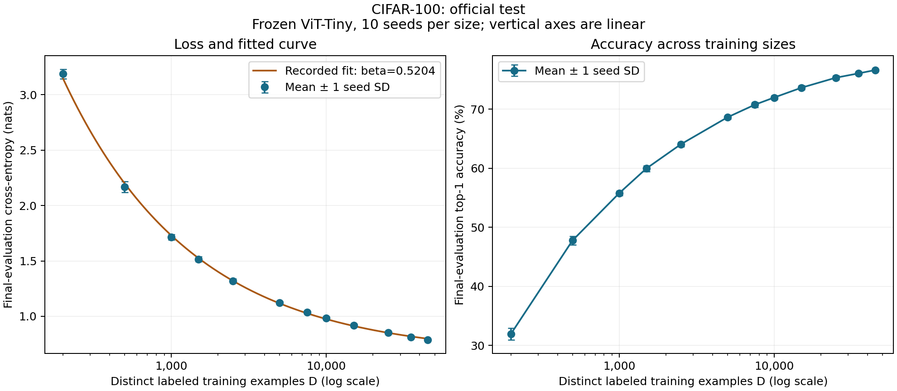
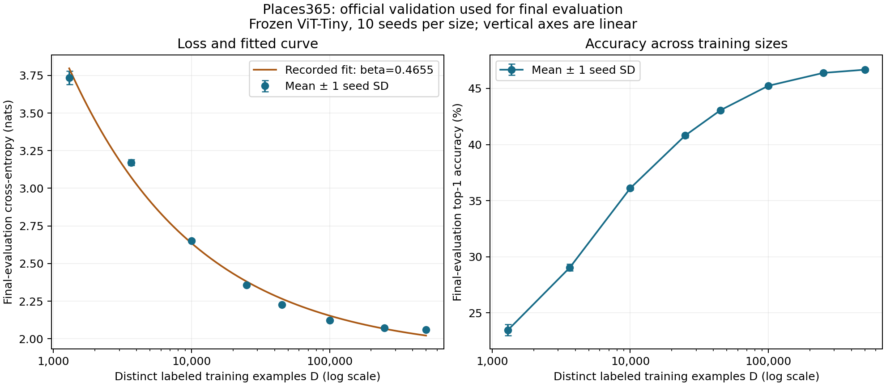
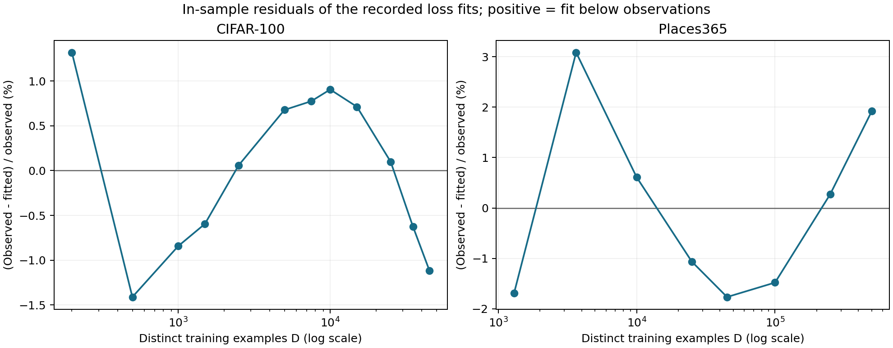
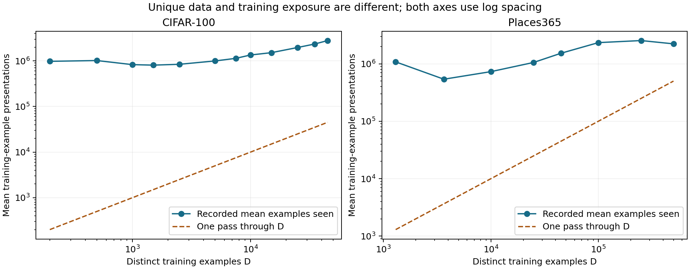

# Thesis progress and evidence report

Evidence review and repository organization: **28 October 2026**. This is a research progress record and a source for later thesis methods, results and discussion chapters; it is not a claim that the thesis experiments are complete.

## 1. Where the project stands

Two main **downstream dataset-size studies** have completed recorded final evaluation: CIFAR-100 (120 runs) and Places365 (80 runs). Both use one pretrained, frozen ViT-Tiny encoder and train a small affine classifier on increasing numbers of labeled examples. In the available evidence, more labels improve accuracy and reduce cross-entropy, with smaller improvements at the largest measured sizes. The archive supports this measured relationship under the chosen recipes. It does not yet establish a universal predictive scaling law, an encoder-size scaling law, a communication bottleneck, or irreducible task error.

The planning documents describe a model-size N sweep at fixed D as an initial thesis experiment. That sweep has not been completed here. The existing D study is useful preparatory work: it builds the measurement pipeline, characterizes label requirements for one representation, and exposes optimization and extrapolation questions. Confirm with the supervisor whether to formalize it as an initial baseline chapter or proceed to the planned N study after resolving the reproducibility gaps.

The original thesis proposal was not in the supplied material. Alignment is against the two local planning DOCX documents and the stated research aims, rather than against a verified original proposal. The [experiment register](../docs/experiment_index.csv) distinguishes completed compact evidence, local exploratory stages, and future work. [Current status](../docs/research_status.md) is the shorter working view.

**A presentation-ready description:** “I studied how labeled training-set size affects an affine classifier on a fixed pretrained ViT-Tiny representation, using nested subsets and ten random seeds. I selected one validation-based optimization recipe per dataset and evaluated the resulting curves on reserved data. I have consistent recorded results for two datasets, but model-size and channel experiments and complete image-to-result reproduction remain future work.”

## 2. Questions and notation

The completed empirical question is: **with a fixed representation and one fixed optimization policy per task, how does final-evaluation loss and accuracy change as the number of distinct labeled head-training examples increases?** Secondary questions concern seed variability, recipe sensitivity, a compact loss-curve description, and the reliability of extrapolation.

| Symbol or quantity | Meaning in this implementation | What it does not measure |
|---|---|---|
| D | Distinct selected source-row IDs used to train the classifier | Encoder pretraining corpus size, repeated presentations, or independently verified unique image content |
| N | Recorded frozen encoder parameter count: 5,524,416 | A swept variable in these experiments |
| m | Encoder output width: 192 | A separately varied transmitted dimension |
| Trainable head | 192×C weights + C biases: 19,300 for CIFAR-100; 70,445 for Places365 | Encoder fine-tuning |
| Steps | Optimizer updates actually executed | Equal wall time across sizes |
| Examples seen | Training-example presentations, including repeats | Distinct D |
| Effective passes | Examples seen / D | An independent sample count |
| Channel/SNR | No channel implemented on this path | Evidence for a noisy-link or bandwidth result |

Parameter-count conventions matter: the encoder count excludes its removed original classifier. Counts including an ImageNet head will differ. “Full-width/noiseless” in metadata describes a baseline, not an implemented transmission module.

## 3. The pipeline, explained step by step

### 3.1 Images, preprocessing and cached features

The configured checkpoint is `vit_tiny_patch16_224.augreg_in21k_ft_in1k`. Its name indicates upstream ImageNet-21k pretraining followed by ImageNet-1k fine-tuning; it is not trained from scratch for this project. The code removes the pretrained classification head, applies the checkpoint-resolved evaluation transform, freezes the encoder, and runs inference without gradient updates. Every image is reduced to a vector of 192 numbers. The affine classifier later sees those numbers rather than image pixels.

Caching is scientifically reasonable for a frozen representation: all classifiers can reuse the same image features, reducing repeated encoder work and preventing augmentation differences between trials. The tradeoff is scope: cached features cannot implement adaptation inside the encoder, and they do not make encoder extraction or inference cost disappear. Training-time augmentation is absent on the cached-head path. The exact historical weight bytes, preprocessing execution and source-image alignment are not independently established by the available summaries; the historical feature tensors are not present locally.

The implementation roles are [feature preparation](../cli/prepare_features.py) and [feature/cache operations](../src/feature_cache.py). The checkpoint name and feature dimensions are recorded in result tables. The decision to freeze and cache is supported by the implemented scope; no evidence establishes that it is the only or optimal thesis-wide design.

### 3.2 Separate training, selection and final evaluation

For CIFAR-100, the 50,000 official training images are divided using 50 validation examples per class: **45,000 training-pool images and 5,000 internal validation images**. The official 10,000-image test split supplies final evaluation. For Places365 standard, the 1,803,460 training images yield **1,785,210 training-pool images and 18,250 internal validation images**, again 50 per class. The official 36,500-image validation split is used as the final-evaluation split because public test labels are unavailable in this workflow. A generic CSV column named `test_loss` therefore refers to official validation for Places365, not to a separately labeled official test set.

The fixed split seed is 12345. Internal validation selects recipes and checkpoints; the final split should remain outside selection. This prevents direct selection on the reported final score. The workflow's intended gate is visible in code and completion records, but saved files alone cannot prove that no person inspected final results at any earlier time. Repeated reuse of the same validation split also creates selection uncertainty not covered by seed error bars.

### 3.3 Select D labeled examples, preserving the task

CIFAR-100 uses exactly class-balanced subsets, so D is divisible by 100. At D=200 there are two training examples per class. Each seed generates a class ordering and progressively takes longer prefixes; the smaller subset is contained in every larger subset for that seed. Places365 uses a class-aware proportional ordering suited to the imbalanced training pool; it preserves coverage and approximates pool proportions rather than imposing equal counts. Its smallest D is 1,300.

Nesting makes the question easier to interpret: increasing D adds data rather than replacing the small dataset with an unrelated draw. Across sizes within a seed the observations are consequently correlated. Ten seeds vary subset membership and classifier initialization/training order; they do not represent ten independently pretrained encoders or ten independent benchmark test sets. At the CIFAR full-pool endpoint, subset membership is identical across seeds while initialization and order can still differ. Source-ID uniqueness does not rule out duplicated or near-duplicated image content.

Implementation: [sampling.py](../src/sampling.py). Local archive checks confirmed nested unique IDs for all 200 main runs. Arrays remain in the external archive, not in this compact repository.

### 3.4 Train the classifier and choose a checkpoint

The classifier computes `scores = W × features + bias`, producing C scores per example. Cross-entropy measures how poorly the scores assign probability to the correct label; lower is better. Top-1 accuracy counts whether the highest-scoring label is correct; higher is better. These metrics answer different questions: probability quality can change even when the predicted class stays the same.

The trainer uses AdamW. The main curves use batch size 256, a constant learning rate, a 30,000-update ceiling, validation every 20 updates, and early stopping after 50 unsuccessful validation checks. An update is accepted as improvement only if validation loss falls by more than 0.00001; the saved checkpoint is the best accepted state under that rule, not necessarily the literal minimum loss to arbitrary precision. Short final batches are retained, so presentations are not always `steps × 256`.

A shared rule aids interpretation, but early stopping produces different realized exposure. Very small datasets can be revisited many times. The ceiling is a convergence safeguard; the near-limit warning is a heuristic, not a proof of global convergence. Example from CIFAR D=45,000/seed 0: selected step 9,500, training stopped at 10,500, 525 validation records; selected validation loss about .80728, final loss .78942 and accuracy 76.73%. Validation and final metrics differ because the examples differ.

Implementation: [probe.py](../src/probe.py). Complete histories and heads were readable in the local audit but are not committed as compact artifacts.

### 3.5 Select one recipe per dataset, then evaluate

HPO means comparing learning rates and weight decay using internal validation. For each candidate recipe h, losses are averaged across seeds separately at each D. The selection score is the equal-weight mean over D of relative regret:

`regret(h) = mean_D [ mean_validation_loss(D,h) / min_candidate mean_validation_loss(D,candidate) - 1 ]`.

This measures how far one recipe falls behind the best observed candidate at each size. Equal size weighting prevents a high-loss small-D point from dominating through its absolute scale. The selected recipe is a compromise across measured sizes. It is not necessarily optimal at every D or for accuracy, and changing the search space or budget changes the reference minima. Regret values from different search stages are not directly a common performance ranking.

The final sweep trains that recipe across all D/seeds. The intended gate requires all runs and no near-budget warning before opening final features. The final score does not choose the checkpoint. [run_hpo.py](../cli/run_hpo.py), [hpo.py](../src/hpo.py) and [run_sweep.py](../cli/run_sweep.py) implement this division. Current software validation limitations are documented below; a completion flag alone is not a full provenance guarantee.

### 3.6 Aggregate, plot and fit

At each D the report shows the arithmetic mean and **sample standard deviation across ten seeds**, using denominator nine. Error bars are ±1 SD, not 95% confidence intervals. The curve fits the size-wise mean cross-entropy:

`L(D) = L_inf + b × D^(-beta)`.

The repository fitter enforces positive parameters through exponentiation, tries 12 starts, minimizes Huber residuals of log predicted total loss minus log observed total loss (`f_scale=.05`), and retains the lowest-cost converged candidate. Every D mean has equal residual weight. It does not weight by seed variance or explicitly model cross-size covariance. `rmse_log_loss` is an in-sample diagnostic after fitting, not predictive accuracy.

The floor `L_inf` is an estimated parameter under this function and protocol. It is not proved irreducible error, a representation ceiling, or a channel-induced floor. Likewise beta describes this dataset/representation/recipe/range; it is not an intrinsic universal constant. [scaling.py](../src/scaling.py) contains the exact fitting objective.

## 4. Scientific progression and what changed

The order below is reconstructed from configurations, reports and artifacts. It is a logical progression, not a verified timestamped record of every run or every human decision. Reasons given retrospectively are explanations of the design, not invented quotations from past decisions.

| Stage | Recorded evidence | Purpose and lesson |
|---|---|---|
| Smoke and three-point pilot | One D=500 smoke run; three-size pilot; early 9-run LR checks | Verify that extraction, training and measurement work; too small for stable scaling conclusions. The smoke folder's “D50” label is misleading. |
| Initial formal baseline | 7 sizes × 5 seeds; 35 runs | Establish a first multi-seed curve under an epoch-based recipe. |
| Learning-rate baselines | LR=.001: 70 runs; LR=.003: 120 runs | Recipe changes alter the curve and fitted exponent; historical comparison is confounded by grid/budget changes. |
| LR pilot | 72 validation trials | A limited 3,000-step search; not the final protocol. |
| CIFAR core HPO | 7,920 trials; 66 recipes × 12 D × 10 seeds | Chose LR=.0001, WD=.01, constant schedule and batch 256. Search ceiling 10,000 steps; mean regret 1.1700%. WD is the upper search edge, so global optimality is unresolved. |
| Main CIFAR curve | 120 runs; 30,000-step ceiling | Same selected recipe across 12 sizes. Primary current CIFAR evidence. |
| Places broad HPO | 5,280 trials; 66 recipes × 8 D × 10 seeds | LR=.0002, WD=.01 at 10,000 steps; mean regret .1717%. |
| Places refinement | 2,400 trials; 30 recipes × 8 D × 10 seeds | Larger 30,000-step ceiling; LR=.0001, WD=.3; mean regret .1320%. WD at upper edge prompted a broader check. |
| Places boundary check | 1,920 trials; 24 recipes × 8 D × 10 seeds | Extended WD range [.1,.3,1,3]; selected LR=.0002, WD=1, interior to tested LR/WD grid; mean regret 3.0199% within this new search. |
| Main Places curve | 80 runs; 30,000-step ceiling | Completed recorded final evaluation with the boundary-selected recipe; supersedes older “pending” status. |

These four imported HPO grids total **17,520 trials**. Main plus historical compact sweep tables contain **425 run records** (200 main and 225 historical); the 72-trial pilot and smaller exploratory folders are listed separately and not silently included in the imported/verified count. Some local folders are partial copies, nested extraction directories, training-only mirrors or compressed duplicates. They are not additional independent experiments. See the [workspace evidence map](../docs/workspace_inventory.md) and [register](../docs/experiment_index.csv).

## 5. Main measured results

The following tables are generated from the original saved aggregates. Accuracy and its SD are expressed in percent/percentage points. Full precision is retained in linked CSVs; rounded values below aid reading. CIFAR and Places scores are not directly comparable measures of intrinsic dataset difficulty because class counts, distributions, training-pool sizes and head dimensions differ.

### CIFAR-100

| D | Mean loss | Loss SD | Mean accuracy (%) | Accuracy SD (pp) | Seeds |
|---:|---:|---:|---:|---:|---:|
| 200 | 3.186658 | 0.042066 | 31.900 | 0.983 | 10 |
| 500 | 2.167684 | 0.048738 | 47.749 | 0.751 | 10 |
| 1,000 | 1.714738 | 0.025782 | 55.748 | 0.387 | 10 |
| 1,500 | 1.514758 | 0.022035 | 59.946 | 0.512 | 10 |
| 2,500 | 1.320409 | 0.016346 | 64.035 | 0.396 | 10 |
| 5,000 | 1.124248 | 0.012444 | 68.605 | 0.259 | 10 |
| 7,500 | 1.035752 | 0.011151 | 70.733 | 0.397 | 10 |
| 10,000 | 0.984019 | 0.009870 | 71.954 | 0.371 | 10 |
| 15,000 | 0.919683 | 0.011019 | 73.615 | 0.353 | 10 |
| 25,000 | 0.852384 | 0.006668 | 75.309 | 0.345 | 10 |
| 35,000 | 0.813987 | 0.004006 | 76.039 | 0.128 | 10 |
| 45,000 | 0.789427 | 0.002086 | 76.608 | 0.134 | 10 |

Evidence: [aggregate](../artifacts/cifar100_main/aggregated_by_D.csv), [individual runs](../artifacts/cifar100_main/summary.csv), [executed configuration snapshot](../artifacts/cifar100_main/config_snapshot.json), [completion](../artifacts/cifar100_main/completion.json), [original fit](../artifacts/cifar100_main/scaling_fit.json). The new figure uses logarithmic D and linear vertical axes; uncertainty is ±1 seed SD.

### Places365

| D | Mean loss | Loss SD | Mean accuracy (%) | Accuracy SD (pp) | Seeds |
|---:|---:|---:|---:|---:|---:|
| 1,300 | 3.734056 | 0.044049 | 23.471 | 0.491 | 10 |
| 3,650 | 3.172077 | 0.018611 | 29.040 | 0.301 | 10 |
| 10,000 | 2.651741 | 0.007733 | 36.104 | 0.151 | 10 |
| 25,000 | 2.356173 | 0.005012 | 40.804 | 0.188 | 10 |
| 45,000 | 2.227382 | 0.001883 | 43.055 | 0.141 | 10 |
| 100,000 | 2.122393 | 0.002238 | 45.233 | 0.095 | 10 |
| 250,000 | 2.072251 | 0.001443 | 46.380 | 0.082 | 10 |
| 500,000 | 2.061073 | 0.003481 | 46.668 | 0.119 | 10 |

Evidence: [aggregate](../artifacts/places365_main/aggregated_by_D.csv), [individual runs](../artifacts/places365_main/summary.csv), [executed configuration snapshot](../artifacts/places365_main/config_snapshot.json), [completion](../artifacts/places365_main/completion.json), [original fit](../artifacts/places365_main/scaling_fit.json). The new figure uses logarithmic D and linear vertical axes; uncertainty is ±1 seed SD.

CIFAR-100 improves from 31.900% at D=200 to **76.608% at D=45,000**; loss falls from 3.186658 to .789427. The final increase from 35,000 to 45,000 is .569 percentage points. Places365 improves from 23.471% at D=1,300 to **46.668% at D=500,000**; loss falls from 3.734056 to 2.061073. The final increase from 250,000 to 500,000 is about .287 percentage points. These are observed changes in the recorded means, not isolated causal estimates with all sources of uncertainty controlled.

### Fitted descriptions and diagnostics

| Dataset | Fitted floor | b | beta | Log-loss RMSE | Sizes |
|---|---:|---:|---:|---:|---:|
| CIFAR-100 | .6493035 | 39.3202948 | .5204128 | .0085705 | 12 |
| Places365 | 1.9029827 | 53.3395673 | .4655409 | .0170068 | 8 |

Independent numerical refits on 28 October reproduce these three parameters within the verifier's tolerance; tiny numerical differences are expected across SciPy versions. This confirms calculation consistency, not validity of the function outside the measured range.

Residuals use `(observed − fitted) / observed`, so positive values mean the curve predicts too little loss. They show departures even where a fitted line looks smooth. A small overall fit error can conceal systematic curvature at endpoints.

The separate [20 October diagnostic derivatives](tables/diagnostics_2026-10-20/README.md) resample whole seed trajectories rather than independently resampling every D. With 100 bootstrap replicates, their conditional 95% beta intervals are [.511927,.529248] for CIFAR and [.458772,.471642] for Places. These are exploratory, coarse intervals conditional on the chosen function, encoder, recipe, fixed data splits and validation selection. They exclude benchmark-sampling, encoder-training, HPO-selection and model-form uncertainty. Narrow intervals do not certify extrapolation, and the bootstrap was not rerun during this organization.

Leave-one-size-out predictions in those saved JSONs expose larger discrepancies: omitting Places D=1,300 produces a loss prediction about 13.86% too high; omitting D=500,000 produces a prediction about 3.71% too low. Omitting a middle size mainly tests interpolation; leaving out the largest size is closer to a forward prediction test. These are retrospective diagnostics, not a prospectively reserved result. Future work should specify forward-size splits before examining the additional outcomes and compare alternative function families on identical splits.

### Data size is different from computation

This figure reads `examples_seen` from saved run tables, including exposure after the best checkpoint until stopping. It therefore describes executed training, not just exposure at checkpoint selection. The one-pass reference equals D. Many runs revisit the same images repeatedly, and early stopping changes total presentations. Constant batch size and maximum updates do not enforce equal realized presentations, equal epochs or equal wall time. Feature extraction, validation and final inference costs are not a complete compute accounting here.

## 6. What the supplied papers teach us about D sweeps

All 15 PDFs were inventoried and their method/experiment passages reviewed for the requested question. Two duplicate pairs leave **13 unique papers**. The [paper-by-paper review](../docs/literature/README.md) records page positions, uncertainty and primary links; the [comparison table](../docs/literature/paper_comparison.csv) maps research question → methodology → relevance. Original papers are not redistributed.

The closest downstream-label precedents are [Scaling Laws for Data-Efficient Visual Transfer Learning](https://doi.org/10.1145/3746027.3754916) (P04: seven uniform fractions from 5% to 100%, categories held fixed) and [Moment Probing](https://openaccess.thecvf.com/content/ICCV2023/html/Gao_Tuning_Pre-trained_Model_via_Moment_Probing_ICCV_2023_paper.html) (P11: 1/2/4/8/16 labeled examples per class, three trials). They support explicit class-aware sizes and repeat measurements. They do not establish that our exact 12- or 8-point grid is uniquely correct, nor do the reviewed passages establish strict nesting for those studies.

[Radiology Foundation Models](https://arxiv.org/abs/2509.12818) (P01) explicitly uses nested pretraining subsets, with more repeated encoders at small sizes. This is useful design precedent for nesting, but its D is upstream data. Its methods are time matched **within a given D**, while duration grows across D; it does not justify claiming our entire D sweep has constant compute. [Scaling Vision Transformers](https://openaccess.thecvf.com/content/CVPR2022/html/Zhai_Scaling_Vision_Transformers_CVPR_2022_paper.html) (P10) combines data, architecture and duration and sometimes reports best-performance envelopes. Our fixed-recipe curve estimates a different object.

[Scaling Pre-training to One Hundred Billion Data](https://arxiv.org/abs/2502.07617) (P12) makes the unique-data/exposure distinction particularly clear: corpus sizes differ while example presentations can be matched. This motivates a **separate future exposure-controlled comparison**; it is not evidence that our current early-stopped curves already provide one. [How to train your ViT](https://openreview.net/forum?id=4nPswr1KcP) (P08) and [Budgeted Training](https://openreview.net/pdf?id=sVzBN-DlJRi) (P05) reinforce that recipe and compute matter, but corpus/class changes and token/computation allocation are not interchangeable with our downstream D.

[Revisiting Neural Scaling Laws](https://proceedings.neurips.cc/paper_files/paper/2022/hash/8c22e5e918198702765ecff4b20d0a90-Abstract-Conference.html) (P09) provides the strongest methodological warning about prediction: compare function families by extrapolation, not solely in-sample fit. Our positive offset power law with Huber log-total-loss residuals is not an exact reproduction of its fitting procedures. Its independent variable can also be examples seen rather than distinct corpus size.

The remaining communication papers and tutorial (P02/P03/P06/P07/P13) inform task objectives, compression, class novelty, latency and channel conditions. No standalone fixed-task unique-label D grid was established from their reviewed experiments. Reporting “no directly applicable D protocol found” is a substantive result: they help define later communication questions but should not be cited as validation of the current sampling or beta values.

**Methodological judgment:** the present design is a reasonable baseline for a fixed-representation label-efficiency question. It follows relevant ideas—reserved selection data, explicit sizes/classes, repeated trials, nested IDs and recorded exposure. The literature does not certify all code or historical execution. The unresolved exposure policy, curve predictiveness, recipe boundaries and provenance must remain visible. The completed curves cannot alone answer the planned N/channel thesis questions.

## 7. Evidence checks, provenance and limits

The [portable compact verifier](../cli/verify_artifacts.py) checks exact configured identities, absence of duplicates, metric ranges, mean/sample-SD agreement, four complete HPO grids, independent global-recipe selection and saved fit agreement. [Recorded verification](../docs/validation/compact_verification.json) covers 425 sweep rows and 17,520 HPO rows. Table gaps are at floating-point roundoff. The fresh [local archive audit](../docs/validation/local_archive_verification.json) additionally opens 200 saved main heads/histories and checks subset IDs; its [source snapshot](../docs/validation/archive_audit_source.py.txt) records the procedure. These checks do not execute head predictions on the original final features, which are unavailable here.

The reorganized GitHub numerical `src/` modules are kept byte-identical to the original clone. Entry points and callers move, and the shell default is corrected to the documented main CIFAR config. The more developed local working project is a different source version; its later repairs are not silently attributed to old runs or merged as part of this organization. The exact historical training source/environment is not established for every stage. Requirement ranges describe installation, not a locked historical execution environment.

A 20 October audit of that newer local code reported 101 passing tests but still reproduced unresolved failure paths around interrupted-run checkpoint/metric generations, aggregate-only HPO reuse, validation-cache size metadata, feature/label and source identity, declared class counts, unknown configuration keys, extraction determinism, promotion binding and random-backbone cache reuse. That is not a claim that this older GitHub implementation received all those fixes or that its own tests number 101. See [implementation status](../docs/implementation_status.md). No reproduced defect was shown to alter the archived main numbers; equally, internally consistent tables cannot exclude all such failures.

Historical raw images and feature tensors are not available in the supplied archive; source-content duplicates, original train/validation/test contamination and tensor-to-label alignment cannot be independently checked. The saved checkpoints, IDs and histories are valuable but do not replace those materials. There is no independent full retraining, pretrained-weight certification or verified chronological access log. Final-evaluation reuse across exploratory stages also limits a claim of a wholly untouched benchmark throughout the project.

The older README's “initialized” description and Places “pending” status are superseded. Original reports and protocols remain visibly marked historical. A formerly missing comparison-report reference is replaced with a navigation note to preserved comparison evidence and this consolidated report. Old commands and status statements inside historical records are not current instructions.

## 8. Next experiments and supervisor decisions

| Priority | Action | Question it resolves | Required evidence |
|---|---|---|---|
| 1 | Agree whether this D baseline becomes a formal thesis study, and recover the original proposal | Which result is required next: D, N or channel? | Supervisor decision and a scoped protocol |
| 2 | Recover original caches/data manifests and exact execution revisions; resolve integrity/reuse gaps before new runs | Can a new run be traced from source images to results? | Weight/preprocessing/data/class-map identities, source revision, environment, checkpoint/metric binding |
| 3 | Predefine fit comparisons and forward-size prediction checks | Does the curve predict unseen larger D adequately? | Declared fit ranges, families, error metric and reserved measurements |
| 4 | Define and run a matched exposure control if compute fairness is the question | Is improvement associated with unique D under a specified shared exposure policy? | Same encoder/splits; explicit total presentations and stopping/selection rules |
| 5 | Investigate CIFAR WD boundary with a new validation-only protocol if optimizing the recipe is needed | Is the selected fixed recipe constrained by the old grid? | Extended search and budget checks; existing final scores do not choose it |
| 6 | Select compatible pretrained encoder sizes at fixed D | How does N affect performance under controlled lineage? | Exact N convention, input/weight lineage, feature/head controls, common compute policy |
| 7 | Introduce a communication module only after baseline-equivalence checks | How do transmitted dimension and SNR affect task utility? | Explicit power/noise definitions, decoder capacity, seed/noise repeats and full-width equivalence |

These are proposed next steps, not completed experiments or automatic instructions to rerun final evaluation. Avoid changing several scientific factors and calling the resulting difference a pure data or model scaling effect.

## 9. How to use this report for the thesis and supervision

For a methods chapter, adapt sections 2–3 and cite the exact snapshot and protocol. For results, use section 5 and the linked raw tables, with uncertainty definitions in captions. For related work, use section 6 plus the page-grounded comparison; check any unresolved details in the original PDF before quoting. For discussion, use limitations, recipe sensitivity and extrapolation diagnostics rather than presenting fitted floors as facts. The development chronology in section 4 explains why stages changed without treating every folder as a separate study.

For the next supervisor meeting, walk through the pipeline, explain one D/seed example, show each main curve and the exposure plot, then present the difference between the completed D baseline and planned N/channel study. A useful closing decision is which question the next protocol should answer. The [script guide](../docs/script_guide.md) provides simple flows and pseudocode for the programs, so the repository can support learning as well as storage.

The README's dated update refers to this evidence reconciliation on 28 October. Existing experiments were not rerun this week, and no unsupported claim is made that their execution dates fall within “last week.” Git history dates track publishing; copied file modification dates do not establish scientific chronology.

## 10. Follow-up review and candidate research question — 29 October 2026

The root-layout code passed 42 tests and compact-table verification after the researcher moved the implementation to the repository root. These are software/evidence-consistency checks, not new scientific experiments. Current navigation/register corrections are included in the root-layout update; [the dated check record](../docs/validation/layout_checks_2026-10-29.json) distinguishes them from the earlier review.

The [expanded comparison](../docs/literature/dataset_sweep_and_novelty.md), [20-row CSV](../docs/literature/dataset_sweep_and_novelty.csv) and [search log](../docs/literature/search_log_2026-10-29.csv) add contribution/gap fields and seven adjacent primary works. Review depth is explicit: three additional method reviews, one framework screen and three abstract-only screens. The original supplied-paper inventory remains 13 unique PDFs.

This extension narrows the novelty boundary. Frozen-probe data comparisons, feature-learning curves and pretrained-feature communication are established ingredients. The proposed question is whether channel width/noise change the *rate or amplitude* of benefit from additional downstream labels, and whether competing descriptions predict reserved larger-D measurements. This is a candidate empirical study, not a certified first-ever result. It should be challenged against the closest work before commitment.

The [proposed protocol](../docs/research_question.md) defines offset-only, common-rate and condition-specific-rate alternatives; separates a small feasibility pilot from formal evidence; and specifies head-capacity, power, convergence, exposure and noise controls. It also preserves the distinction between the planning documents' N-first sequence and a later D-by-channel study. Feature-cache recovery and known integrity issues remain prerequisites. No candidate-channel outcome, exponent change, target-data requirement or new experimental result is asserted here.
